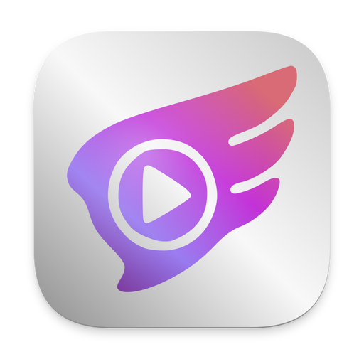
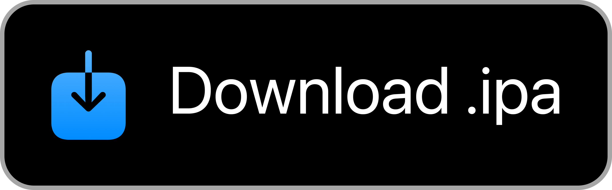

  

  

Synkplay is an unofficial [Syncplay](https://syncplay.pl/) client for Android, iPhone, iPad and Android TV. It keeps a video in step for everyone in a room, which means that when one person pauses, plays or skips, the others do too. It speaks the same protocol as the official Syncplay client, which lets friends on a computer join the same room.

Everyone plays their own copy of the video (from a file or a link) because Synkplay never sends your video or your screen to anyone. It only keeps the playback in step.

## Download

<table align="center">
  <tr>
    <th align="center">Android</th>
    <th align="center">iPhone &amp; iPad</th>
  </tr>
  <tr>
    <td align="center">
      
    </td>
    <td align="center">
      
    </td>
  </tr>
  <tr>
    <td align="center">
       Full APK
    </td>
    <td align="center">
       IPA for sideloading
    </td>
  </tr>
  <tr>
    <td align="center">
       ExoPlayer only
    </td>
    <td align="center">
       AltStore source
    </td>
  </tr>
</table>

Synkplay needs Android 8.0 or newer, or iOS 15.0 or newer. The stores review every build before they publish it, which is why a store update can arrive later than the GitHub release.

Synkplay has no computer version yet, since its browser version is still early and cannot join a room. On a computer, use the [official Syncplay client](https://syncplay.pl/download/) instead.

<b>Which download should I pick?</b>

- **Google Play** is the easiest way on Android. The APK on GitHub is the same app, with all three video players (mpv, ExoPlayer and KitePlayer).
- **IzzyOnDroid** has a smaller build with ExoPlayer only. Android treats it as a separate app instead of an update to the full one, which means the two can sit side by side with their own settings.
- **On iPhone and iPad**, use the App Store. To sideload instead, [set up AltStore Classic](https://faq.altstore.io/) and tap **Add to AltStore** above.

## Start a room

1. Everyone joins the same room, which means the same server, port and room name. The official Syncplay server (syncplay.pl) is filled in for you.
2. Everyone opens the same video, from a file on their device or from a link.
3. Press play once everyone shows as **Ready**. Synkplay marks you as ready when you join (you can turn that off in the settings).

To invite friends, tap **Share the room** inside the room and send them the link. It opens a web page that can open Synkplay or install it, and pasting it into the room field on Home fills in the server, the port, the room name and the password. Since the link carries the room password, send it only to the people you want in the room.

To watch something by yourself, tap the logo on Home and pick **Watch alone**, which needs no server.

## What else it does

The room has a chat with emoji and GIFs, along with a shared playlist that plays the next file by itself. You can load subtitle files or search OpenSubtitles from the room, set your own time offset when your copy has a longer intro, or host a room on your own device with **Host mine** on Home.

Picture-in-picture works on Android, and on iOS with VLCKit or AVPlayer. On servers that support them you can also use managed rooms (where only the room operators control playback) and encrypted connections. You decide whether the room sees your file name and size as they are, hashed, or not at all. On Android TV the whole app works with the remote.

## Screenshots

  
  &nbsp;&nbsp;
  

## Help

<b>A video or subtitle does not play right</b>

Leave the room, pick another video player on Home (Synkplay calls them engines) and join again. Home shows what each engine supports, and the [engine table](docs/DEVELOPING.md#engine-capabilities) compares them all.

The default engine is mpv in the full Android app, ExoPlayer in the IzzyOnDroid app and VLCKit on iOS. KitePlayer is still experimental, and AVPlayer cannot load subtitle files.

For anything else you can [report a bug](https://github.com/yuroyami/syncplay-mobile/issues/new?template=bug_report.yml), [ask a question](https://github.com/yuroyami/syncplay-mobile/discussions) or [request a feature](https://github.com/yuroyami/syncplay-mobile/issues/new?template=feature_request.yml).

## Contributing

Translations help the most, and you can add one on [Weblate](https://hosted.weblate.org/engage/syncplay-mobile/). Bug reports with steps to reproduce are welcome too, as are tested patches. [DEVELOPING.md](docs/DEVELOPING.md) explains how to build and test the app, and how to [check that a published APK matches the source](docs/DEVELOPING.md#reproducing-a-published-apk). If you want to support development, there is a [Ko-fi page](https://ko-fi.com/sidenaakram).

<b>Credits</b>

- [Syncplay](https://syncplay.pl/) and [Et0h](https://github.com/Et0h), for the original project and their help.
- [soredake](https://github.com/soredake), for testing.
- [Osanosa](https://github.com/Osanosa), for contributions.
- [mukulhase](https://github.com/mukulhase), for Android TV support.
- [mvanhorn](https://github.com/mvanhorn), for the Home keyboard fix.
- [Zhaodaidai](https://github.com/Zhaodaidai), [DoncanC](https://github.com/DoncanC), [ivy-reps](https://github.com/ivy-reps) and everyone translating on Weblate.

## License

Synkplay is free software under the [AGPL-3.0 license](LICENSE). The [release notes](CHANGELOG.md) list what changed in each version, and the [privacy policy](PRIVACY_POLICY.md) covers what happens to your data.
